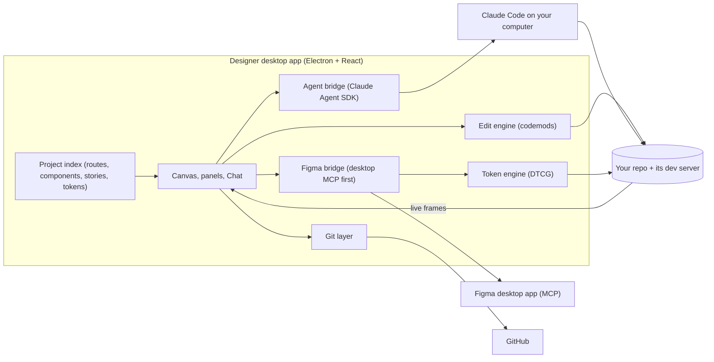

# Designer

**A Figma-style canvas for your real codebase, driven by the Claude Code already on your computer.**

Designer is a desktop app for product designers. You open your team's repository, see the live product and its components on an infinite canvas, and change them the way you would in a design tool. Your changes become real code through your local Claude Code, and you hand them to developers as a pull request, without touching git or a terminal.

> **Status: early prototype.** The interface and flows are designed and clickable. The AI is simulated in the prototype. The local app that drives Claude Code is the next milestone (see [Roadmap](#roadmap)).
>
> [Try the clickable prototype](https://claude.ai/artifact/MWMd2fJTtkMxULsEz61p6j) · [Read the product plan and architecture](docs/plan.md)

---

## The problem

Designers who want to build with AI today have to pick one of two kinds of tool, and neither does the whole job.

| | AI inside a design tool | An AI coding agent such as Claude Code | **Designer** |
| --- | --- | --- | --- |
| Knows your design variables, components and frames | Yes | Only as text, through an MCP server | **Yes, shown in panels** |
| Knows your real repository, components and conventions | No | Yes | **Yes** |
| Visual canvas you can select, move and tweak | Yes | No (terminal or IDE) | **Yes** |
| AI cost | Credits included in a design-tool plan, with monthly caps | Your own Claude plan or API key | **Your own Claude Code** |
| What you end up with | A prototype that developers rebuild | Code in the repository | **Code in the repository, as a pull request** |
| Seeing teammates' changes | No | `git pull` in a terminal | **One "Get latest" button** |

Design-tool AI runs out of credits and does not know the codebase, so what it makes has to be rebuilt by hand. A coding agent knows the codebase but has no canvas, no direct manipulation, and only a text view of the design system. Designer puts the two together: **the repository is the source of truth, and the design tool is an input.**

## What Designer does

- **Shows your running product on a canvas.** Each frame is a live render of a route or a story from your repository's own dev server. Click any element to select the component and the line of code behind it.
- **Edits like a design tool and writes code.** You change padding, variants, sizes, colours and themes in a properties panel. Simple changes are written straight to source with codemods. Anything structural goes to Claude.
- **Puts Claude on the canvas.** You select something and ask: "make these cards denser", or "add an empty state". Claude edits a scratch copy of the repository and the frame reloads. You compare Before and After, then Keep or Discard. The conversation continues in a Chat tab, with plans, checkpoints and Rewind.
- **Brings in design pages.** You select frames in the Figma desktop app and import them. They land beside your live screens as editable design frames, and their variables are offered as a reviewed diff against your tokens.
- **Builds components that don't exist yet.** If an imported design uses a component your code doesn't have, Designer flags it as "Not in code". Claude then builds it from the component set, with every variant, a story and your tokens. It checks the result against the design and links the two.
- **Gives you a design-system workbench.** If your repository uses Storybook, Designer reads the stories and renders every component as a live variant matrix, in its own view. Storybook's interface is never run or shown. In this view you can:
  - switch the theme and the state
  - change preview props
  - edit the main component's tokens and see how far each change reaches
  - see where code and design have drifted apart
- **Hides git behind four actions.** Get latest, Save version, Share for review and Undo. Branches, commits, pushes and pull requests happen underneath.

## Key features

| Feature | How it works |
| --- | --- |
| **Uses your local Claude Code** | Drives the `claude` you already have installed, through the [Claude Agent SDK](https://code.claude.com/docs/en/agent-sdk/overview), with its sign-in, settings, `CLAUDE.md`, skills, MCP servers and hooks. You choose the model, the effort and the mode (Ask before edits, Plan first, Auto-accept edits). Sessions can be resumed, and checkpoints let you rewind. |
| **Figma import through the desktop MCP server** | Recommended, because it needs no token. Designer connects to the Figma desktop app's local MCP server and reads whatever you have selected. Signing in to Figma (remote MCP) and a personal access token (REST API) are fallbacks for when the desktop app is closed or you pick a file by link. |
| **Live frames with click-to-source** | A dev-only build plugin tags every JSX element with its source location. A small bridge script in each frame handles hit-testing, measurement and instant style previews. |
| **Tokens, never raw values** | One token model in DTCG format, with adapters for design variables, CSS custom properties, Tailwind themes and Style Dictionary. Syncing always produces a diff for you to review, never a silent overwrite. |
| **Components from stories** | The app parses CSF stories (`args`, `argTypes`) into variant axes. If a repository has no stories, Claude writes them first. |
| **Missing component to code** | Detect, gather, plan (you rename the props), build, compare pixel by pixel against each variant, then link with Code Connect. |
| **Designer-friendly git** | One branch per designer, plain-language versions, pull requests with before and after screenshots, and Claude proposing fixes for merge conflicts before a developer is asked. |
| **Local-first** | Your repository, dev server and Claude Code all run on your machine. The only network calls go to the design tool, to Claude and to your git remote. |

## Architecture at a glance



The interface never writes code itself. It sends typed edit intents, such as `{ target: "Card.tsx:42:6", change: { padding: "space.6" } }`. Those intents go one of two ways:

- **Fast path:** a deterministic codemod (ts-morph, recast, PostCSS).
- **Slow path:** Claude Code, running on a scratch git worktree, so your working copy stays untouched until you choose Keep.

Either way, the dev server hot-reloads and the canvas follows.

| Layer | Choice |
| --- | --- |
| Shell | Electron and TypeScript, so frames render in the same Chromium everywhere and the toolchain is all Node |
| UI | React, Zustand, Radix primitives |
| AI | Claude Agent SDK driving the locally installed Claude Code |
| Design tool | Figma desktop MCP server, with the remote MCP server, the REST API and a companion plugin as fallbacks |
| Tokens | DTCG JSON and Style Dictionary |
| Git | System git through simple-git, GitHub OAuth device flow |

The full design is in [docs/plan.md](docs/plan.md). It covers every component, the data flows, the risks and the open questions.

## Repository layout

```
docs/plan.md                    Product plan and architecture
prototype/workspace.dc.html     Source of the clickable UI prototype
LICENSE                         Apache License 2.0
NOTICE                          Attribution and trademark notice
```

## Roadmap

- [x] **Plan and architecture.** Problem, principles, components, data flows, risks.
- [x] **Clickable prototype.** These flows all work, with simulated AI:
  - canvas with live frames, drawing tools, pan and zoom
  - Chat tab, models, effort and modes
  - Figma import with desktop MCP recommended
  - building a missing component
  - Components view, Save version, Share for review, Get latest and Undo
- [ ] **Phase 0 spikes.** Each runs end to end on one real Vite, React and Tailwind repository:
  - a live frame with click-to-source
  - local Claude Code editing a worktree from a canvas selection
  - one Figma page imported as a design frame
  - one missing component generated and compared
- [ ] **Phase 1 MVP (macOS).**
  - open or clone a repository, routes shown as pages, Design and Tokens panels
  - fast-path codemods, Ask AI and Chat
  - Figma desktop MCP import
  - Components view for Storybook repositories
  - the four git actions
- [ ] **Phase 2.** Two-way token sync, full editing of design frames and Send to Figma, Windows build.
- [ ] **Phase 3.** Comments that map to pull request reviews, presence, more frameworks, prototype links between frames.

## Contributing

The project is at the design stage. Issues are open for feedback on the plan, the prototype and the open questions in [docs/plan.md](docs/plan.md#open-questions-and-next-steps). Code contributions will open with the Phase 0 spikes.

## License

Licensed under the [Apache License, Version 2.0](LICENSE). Apache 2.0 was chosen for three reasons:

- It is permissive, so teams can adopt the app and build on it freely.
- It includes an explicit patent grant, which protects users and contributors.
- It states that it grants no rights to trademarks. That matters for a tool that works with other companies' products.

## Trademarks

Figma is a trademark of Figma, Inc. Claude and Claude Code are trademarks of Anthropic, PBC. Storybook and GitHub are trademarks of their respective owners. These names are used only to describe what Designer works with. Designer is an independent project and is not affiliated with, endorsed by, or sponsored by any of these companies. Designer follows familiar design-tool interaction patterns but uses its own name, logo, icons and colours, and includes no third-party brand assets.

Using Designer with Claude requires your own Claude Code installation or Anthropic API key, under Anthropic's terms. A build distributed to other people should use API keys rather than consumer sign-in, unless Anthropic has approved otherwise.
