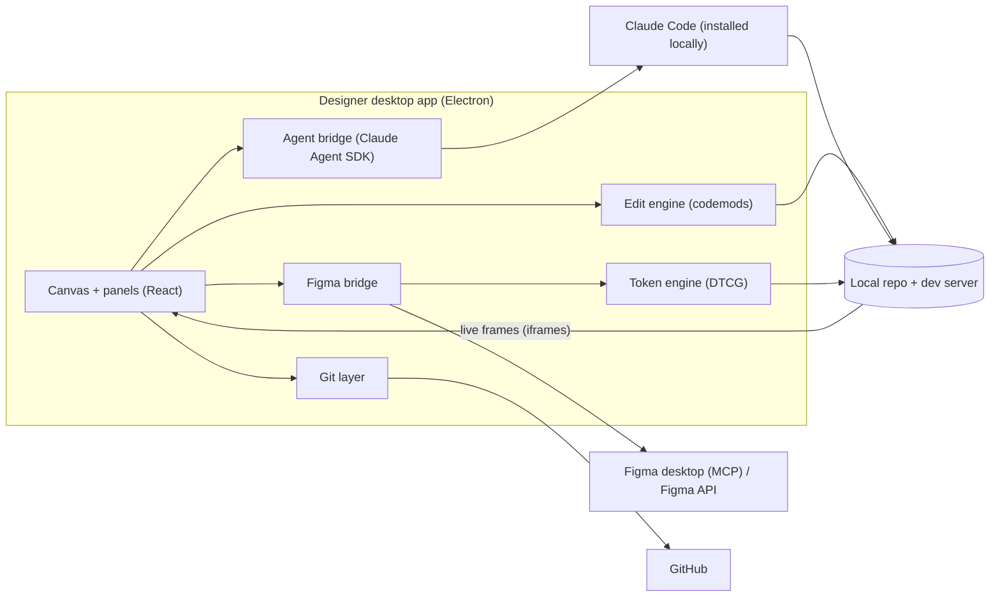

# Designer: Product Plan & Architecture

*Written 18 November 2026. Living document; the latest decisions are reflected in the README.*

## Summary

Build a local desktop app (working name **Designer**) whose canvas renders the team's real components from the repo, not pictures of them. Designers move, tweak and prompt on that canvas the way they would in Figma, and the edits become code through the Claude Code already installed on their machine.

The core bet: **the repo is the source of truth, Figma is an input**. We pull variables, components and frames from Figma when they help, but what designers see and change is the running product. That removes the hand-off gap Figma Make has (no repo) and the design gap Claude Code has (no canvas, no tokens).

Git stays out of sight. Designers see four actions: **Get latest**, **Save version**, **Share for review**, **Undo to a version**. Behind them sit branches, commits, pushes and pull requests.

## Problem and who it's for

Today a designer has to choose between a tool that understands design and a tool that understands the product. Neither does both.

|  | Figma Make | Claude Code alone | Designer (this app) |
| --- | --- | --- | --- |
| Sees Figma variables, components, frames | Yes | Only through the Figma MCP server, as text | Yes, pulled and shown in panels |
| Sees the team's real repo and components | No | Yes | Yes |
| Visual, direct-manipulation canvas | Yes | No, terminal or IDE | Yes, Figma-style |
| AI cost model | Figma AI credits, capped | The user's own Claude plan or API key | The user's own Claude Code |
| Output ships | Prototype, rebuilt by devs | Code in the repo | Code in the repo, via a pull request |
| Sees teammates' changes | No | `git pull` in a terminal | One **Get latest** button |

**Primary user:** a product designer on a team that already has a front-end repo (React first) and a Figma library. They are comfortable in Figma, not in a terminal.

**Secondary user:** the front-end developer who reviews the designer's pull requests and wants changes that use the existing components and tokens, not one-off CSS.

## Product principles

1. **Feels like Figma, is not Figma.** Copy the interaction grammar designers already have in their hands: layers on the left, canvas in the middle, properties on the right, the same keyboard shortcuts (V, F, R, T, K, Shift+A for auto layout, Cmd+D, Cmd+G, Cmd+/ for quick actions), frames, zoom to fit, smart guides, red spacing measurements on Alt-hover. Use our own name, icons, colours and logo; no Figma brand assets. The app's primary colour is black (#111111) on light greys.
2. **Real components on the canvas.** Every box a designer touches maps to a component instance or element in the code. No parallel vector document that drifts from the product.
3. **Tokens, never raw values.** The properties panel offers the repo's tokens (Figma variables after sync) first. Picking a raw hex or px is possible but flagged, the way Figma flags detached styles.
4. **AI is a tool in the toolbar, not a chat app.** Prompting happens on a selection ("make this card denser", "add an empty state") and the result lands on the canvas as a proposal the designer accepts or discards.
5. **Git is invisible but honest.** Four plain actions, a version history that reads like Figma's, and a clear badge when something needs a developer.
6. **Local-first.** Repo, dev server and Claude Code all run on the designer's machine. Nothing leaves it except calls to Figma, to Claude, and the git remote.

## Designer experience

The workspace mirrors Figma's layout so nothing needs to be learned twice.

| Area | What it holds | Figma equivalent |
| --- | --- | --- |
| Top bar | File menu, tool picker (Move, Frame, Text, Shape, Comment, **Ask AI**), branch name shown as a version label, **Get latest** and **Share** buttons, presence avatars later | Toolbar and share button |
| Left panel, Layers tab | Tree of the selected screen: components and elements, named after the component (`Button`, `Card`), with hide and lock | Layers panel |
| Left panel, Assets tab | The repo's components, grouped like a library, each with a live thumbnail; drag onto the canvas to insert | Assets panel |
| Left panel, Pages tab | Routes and stories found in the repo (`/settings`, `Button.stories`) shown as pages | Pages list |
| Canvas | Infinite canvas of frames; each frame is a live render of a route or story at a chosen device size | Canvas and frames |
| Right panel, Design tab | Layout (auto layout as flex/grid), spacing, size, fill, stroke, type, effects, plus the component's props (variant, size, disabled) | Design panel and component properties |
| Right panel, Tokens tab | Colour, spacing, radius and type tokens with modes (light, dark, brand) | Local variables |
| Right panel, Inspect tab | The code behind the selection and the file it lives in, read only | Dev Mode inspect |
| Bottom bar | AI activity ("Claude is editing Card.tsx"), dev server status, unsaved changes count | n/a |

### Key flows

1. **Open a project.** Pick a folder or paste a GitHub URL. The app clones if needed, detects the framework, installs dependencies, starts the dev server and shows routes as pages. First run takes minutes; later runs take seconds.
2. **Connect Figma (optional).** With the Figma desktop app open, the app connects to Figma's desktop MCP server: no token needed. Sign-in or a personal token are fallbacks. Variables become tokens, components get matched to code components, frames become reference images you can place beside a live frame.
3. **Tweak directly.** Select an element, change padding from 16 to 24 in the Design tab. The canvas updates instantly from a style overlay; in the background the change is written to source (deterministically when we can, through Claude when we can't).
4. **Ask AI on a selection.** Press K or the Ask AI tool, type "add an empty state with an illustration slot". Claude edits the repo on a scratch branch, the frame reloads, and the designer gets **Keep** or **Discard**, with a before/after toggle.
5. **Design from a Figma page.** Import a Figma page (or paste a frame link). Its frames land on the canvas as editable design frames that designers keep working on with the same tools. When one is ready, Convert to code asks Claude to build it from the repo's own components. The Figma frame stays beside the result as an overlay for comparison.
6. **Save version.** Names the change in plain words ("Denser cards on Settings"), commits it, and pushes to the designer's own branch. History shows saved versions as a list with thumbnails.
7. **Share for review.** Opens a pull request with before/after screenshots and a summary written by Claude. Developers review in GitHub as usual.
8. **Get latest.** Pulls the main branch into the designer's branch. Every open frame hot-reloads, so a developer's change to `Button` shows up on the canvas without any other step. Conflicts are handed to Claude first and to a developer second, never to the designer as raw conflict markers.

## Architecture overview

One desktop app runs on the designer's machine and coordinates four things it does not own: the repo, Claude Code, Figma and GitHub.

The UI never writes code itself. It sends intents to the services below it, which write to the repo directly (codemods, tokens) or through Claude Code; the dev server then re-renders the canvas.

## Key components

### 1. Desktop shell

An Electron app (main process in Node, UI in React). It owns windows, the file system, child processes (dev server, git, Claude Code) and secure storage of the Figma token. Electron over Tauri because the canvas must embed Chromium-rendered pages from the dev server with identical rendering on macOS and Windows, and the whole toolchain we drive (Agent SDK, dev servers, git libraries) is Node.

### 2. Canvas and live renderer

The hardest and most important part. The canvas is our own layer (pan, zoom, selection, guides, measurements) drawn over a grid of **frames**. Each frame is a sandboxed iframe pointing at the repo's own dev server (Vite or Next first) at one route or Storybook story, sized to a device preset.

- **Instrumentation.** A dev-only Babel/SWC plugin (or Vite plugin) we inject tags each JSX element with its source location (`data-src="Card.tsx:42:6"`) and component name. This is what makes click-to-select map to a line of code and a component, and powers the Layers tree.
- **Bridge script.** A small script injected into each frame talks to the canvas over `postMessage`: hit-testing, bounding boxes, computed styles, React fibre walk for props, and applying temporary style overrides for instant feedback.
- **Isolation.** Components can also be rendered alone through the repo's Storybook (if present) or a generated harness page, which feeds the Assets panel thumbnails.

### 3. Edit engine (canvas edits to code)

Every canvas change becomes a typed edit intent: `{target: "Card.tsx:42:6", change: {padding: "space.6"}}`.

- **Fast path, deterministic:** for known patterns (Tailwind classes, a CSS module rule, a styled-components prop, a component prop like `variant`) a codemod (ts-morph / recast) rewrites the source directly. Milliseconds, no AI cost.
- **Slow path, Claude:** anything structural or ambiguous (wrap in auto layout, reorder children, new component) is batched into a prompt to Claude Code with the intent, the source location and a screenshot.

### 4. Agent bridge (Claude Code)

Runs Claude Code headless through the **Claude Agent SDK** (TypeScript `query()`), which drives the Claude Code binary with its built-in tools, permissions, sessions, hooks and MCP. For each AI request it:

- builds a prompt from the selection, intent, screenshot, design rules file and token list;
- runs on a scratch git worktree so the main working copy is untouched until **Keep**;
- restricts tools with permission rules (edit inside `src/`, run the package manager and tests, no network push);
- connects the Figma MCP server and our own local MCP server (exposing canvas state: `get_selection`, `get_tokens`, `screenshot_frame`) so Claude can look at what the designer sees;
- streams progress to the bottom bar and resumes the session for follow-ups ("a bit more spacing").

### 5. Figma bridge

Recommended: Figma's desktop MCP server. It needs no token and reads whatever the designer has selected while the Figma desktop app is open, so importing is "select in Figma, click Import". Signing in to Figma (OAuth, remote MCP) and a personal access token (REST) stay as fallbacks for when the desktop app is closed or a file is picked by link. The sources:

| Source | What we use it for | Limit |
| --- | --- | --- |
| Figma desktop MCP server (recommended) | Default import: frames, components and variables for the current selection in Figma desktop; screenshots and design context for Claude | Figma desktop must be open with the file; works on the selection |
| Figma MCP server (remote, sign in to Figma) · fallback | Design context for a frame, screenshots, `get_variable_defs`, Code Connect maps, `search_design_system`; also `use_figma` / `generate_figma_design` to push UI back into Figma | Per-seat rate limits; needs the user's Figma sign-in |
| Figma REST API (personal access token) · fallback | File tree, components, styles, image exports, comments; webhooks for library publishes | Variables endpoints are Enterprise only |
| Our companion Figma plugin | Reads and writes variables and collections on any plan through the Plugin API, and sends selections to the app | User must run the plugin in Figma |

### 6. Token engine

Keeps one normalised token model (DTCG JSON format, with collections and modes) and adapters on both sides: Figma variables in and out, and the repo's format in and out (CSS custom properties, Tailwind theme, a TS theme object, Style Dictionary). Sync is a diff the designer reviews, never a silent overwrite. Each token remembers its Figma variable id so renames survive.

### 7. Git layer

Wraps git (system git via `simple-git`, with `isomorphic-git` as a fallback) behind the four actions. Each designer works on their own branch (`design/grace/denser-cards`). Pushes and pull requests go through GitHub (OAuth device flow). Conflicts go to Claude for a proposed resolution, then to a developer if Claude is not confident.

### 8. Project index

Scans the repo on open: framework, routes, components and their props (from TypeScript types), stories, token files and design-rule files (`CLAUDE.md`, Figma's `create_design_system_rules` output). Feeds the Pages, Assets and Tokens panels and every AI prompt.

### 9. Design frames (Figma pages rendered on the canvas)

The canvas holds two kinds of frame side by side: **live frames** (the repo running) and **design frames** (Figma pages imported as real, editable layers). This lets designers keep designing freely when there is no code yet, and compare design with product on one board.

- **Import.** Pick a Figma file and page (or paste a page or frame link). We fetch the node tree with the REST API `GET /v1/files/:key/nodes` (geometry=paths), plus image fills and the variables bound to each node (MCP `get_variable_defs`, or the companion plugin on non-Enterprise plans).
- **Scene graph.** Nodes become our own document model, close to Figma's: frames, groups, auto layout, rectangles, vectors, text, component instances with variant properties, and variable bindings. It is saved in the repo as JSON under `design/` so it is versioned, pulled and pushed like code.
- **Renderer.** Design frames are drawn by our own renderer: DOM/CSS for frames, auto layout (as flexbox), text and images, and SVG for vectors and boolean shapes. That keeps fonts and text layout identical to the live frames beside them. A WebGL renderer (e.g. a CanvasKit/Skia build) is the later option if large files get slow.
- **Editing.** The same tools work on both kinds of frame: move, resize, auto layout, fills bound to tokens, swap component variants. Edits on design frames change the JSON, not the code.
- **Linking to code.** Instances whose component is matched to a code component (Code Connect or our own matching) carry a link. **Convert to code** sends a design frame to Claude to build as a real route or component from the repo's parts; the result opens as a live frame next to the design for an overlay check.
- **Round trip to Figma.** **Refresh from Figma** re-imports the page and shows a diff. **Send to Figma** writes design-frame changes back through the companion plugin or the MCP server's `use_figma`, so Figma stays in step for people who never open the app.
- **Fidelity.** Common features render exactly; rarer ones (complex blend modes, some effects, prototype interactions) are drawn as a flattened image with a badge, rather than wrong.

### 10. Component generator (Figma component to new code component)

When a Figma component has no match in the repo, the app builds it instead of faking it with raw markup.

1. **Detect.** On import, each Figma component and instance is matched against the project index: Code Connect maps first, then name and prop similarity. Unmatched ones get a **Not in code** badge in Layers and Assets.
2. **Gather.** For the component set we pull every variant and property (variant, boolean, text, instance swap), auto layout, bound variables, and a screenshot per variant (MCP `get_design_context`, `get_variable_defs`, `get_screenshot`).
3. **Plan.** Claude proposes a props API that maps Figma properties to code props (`Variant=Primary` to `variant="primary"`), which existing components it will reuse inside (an `Icon`, a `Button`), and where the file goes, following the repo's conventions from the project index. The designer sees this as a short card and can rename props before anything is written.
4. **Build.** Claude Code writes the component, a story with every variant, and tokens instead of raw values, on a worktree. Missing tokens are added through the token engine, not inlined.
5. **Check.** The app renders each variant as a live frame next to its Figma variant and shows a pixel diff overlay. Claude iterates until the diff is under a threshold or asks the designer to judge.
6. **Link.** On Keep, the app records the mapping (Code Connect via `add_code_connect_map`, plus our own map file), so every instance of that Figma component on any page now renders as the real code component. The new component appears in the Assets panel and ships in the next **Share for review**.

### 11. Claude controls (local Claude Code, model, effort, modes)

Claude is a visible, configurable part of the app, not a black box. A chip in the top bar shows the current setup and opens the full settings; the Ask AI bar repeats the three most-used controls.

| Control | Options | How it maps to Claude Code |
| --- | --- | --- |
| Runs on | Claude Code on this computer (found on PATH, uses its sign-in) or an Anthropic API key | Agent SDK `pathToClaudeCodeExecutable`; API key for distributed builds |
| Model | Opus, Sonnet, Haiku (current versions listed at runtime) | `model` option per request |
| Effort | low, medium, high, xhigh, max | effort / thinking setting per request |
| Mode | Ask before edits, Plan first, Auto-accept edits | permission modes `default`, `plan`, `acceptEdits` |
| Memory, skills, MCP, hooks | Read from the repo's `.claude/` and the user's `~/.claude/` | SDK loads project and user settings, skills, MCP servers and hooks |
| Checkpoints | Rewind any AI change | file checkpointing plus our scratch worktree |
| Sessions | One per version (branch), resumable | SDK sessions: resume and fork |
| Subagents | Build variants or stories in parallel | SDK subagents |

Plan-first mode shows Claude's plan as a card the designer approves before any file changes, which suits bigger asks. The status bar always says which model, effort and mode is active, and a usage meter shows how full the session's context is.

### 12. Project and repo connection

The repo chip in the top bar names the connected folder and opens its details: path, remote, current version (branch), framework, Storybook, token file, rule files (`CLAUDE.md`) and dev-server state, plus **Open another folder** and **Clone from GitHub**. On first open the app asks the user to trust the folder before installing or running anything.

### 13. Components view (a design-system workbench built from stories)

A second top-level view next to Canvas. If the repo has Storybook, we **parse its stories** (CSF files: `args`, `argTypes`, decorators) with the project index and render each component in our own harness inside the app. We never run or show Storybook's UI. With no Storybook, Claude writes stories first.

- **Tree:** Foundations (colours, type, spacing from the token file) and Components, each with its story count and a dot for Figma status: matches, differs, or not in Figma.
- **Variant matrix:** every enum `argType` becomes an axis, so a Button shows variants down and sizes across, live. Light and dark theme and default, hover, focus and disabled states switch the whole matrix at once.
- **Preview props vs main component:** the right panel separates props that only change the preview (from story args) from **main component** styles that edit the source file (radius, weight, padding tokens). Each main edit shows its reach ("23 instances in 9 files") and updates every frame on the canvas. This mirrors Figma's main-component and instance model.
- **Figma drift:** for linked components we compare each variant with Figma and list the differences, with **Match Figma in code** or **Update Figma**.
- **Stories and usage:** stories as chips, where the component is used (routes and other components), and Claude actions: add a variant, write missing stories, check contrast and focus states, place on canvas.

The Assets panel on the canvas and this view share one model, so a component built from Figma, or changed by a teammate after **Get latest**, appears in both.

## Data flow

Four loops carry all the traffic. Each one ends in the repo, so a `git pull` is always enough to see someone else's work.

**A. Figma to app (pull design in)**

1. Designer selects frames in the Figma desktop app (or, as a fallback, picks a file by link).
2. Figma bridge reads nodes, images and variables through the Figma desktop MCP server (fallbacks: remote MCP with sign-in, REST with a token, or the companion plugin).
3. Token engine diffs Figma variables against repo tokens; designer accepts the diff; token files are rewritten.
4. Pages become design frames saved as JSON in `design/`.

**B. Canvas edit to code**

1. Designer changes a property on a live frame; the bridge script applies a temporary style override at once.
2. Edit engine turns it into an intent with a source location.
3. Codemod writes it (fast path) or the agent bridge asks Claude Code (slow path) on a scratch worktree.
4. Dev server hot-reloads; the override is dropped once the real render matches.

**C. Save and share**

1. **Save version** commits to the designer's branch and pushes.
2. **Share for review** opens a pull request with screenshots of every changed frame and a summary.
3. Optional: **Send to Figma** pushes updated tokens and design frames back to the Figma file.

**D. Get latest**

1. Fetch and merge `main` into the designer's branch (Claude proposes fixes for conflicts).
2. Dev server hot-reloads, so live frames show developers' changes immediately.
3. Token and design-frame files changed by others re-render; the project index refreshes the Assets panel.
4. A webhook or poll on the Figma file shows a dot on **Refresh from Figma** when the library was published.

## Tech stack

| Layer | Choice | Why | Alternative |
| --- | --- | --- | --- |
| Shell | Electron + TypeScript | Same Chromium everywhere for live frames; Node for SDK, git, dev servers | Tauri: smaller, but WebKit on macOS renders frames differently |
| App UI | React, Zustand for state, Radix primitives | Fast to build Figma-like panels, accessible menus and popovers | Solid / Svelte |
| Canvas chrome | Custom layer over iframes, CSS transforms for pan and zoom | Live frames must stay real DOM; selection, guides and measurements drawn in an overlay | tldraw SDK as a starting point for canvas mechanics |
| Design-frame renderer | DOM/CSS + SVG from our scene graph | Text matches live frames; easy hit-testing | CanvasKit (Skia WASM) later for very large files |
| Code instrumentation | Vite/Babel/SWC plugin adding source locations | Click-to-source and Layers tree | React DevTools hook only (no file locations) |
| Codemods | ts-morph, recast, PostCSS | Deterministic edits for common changes | Always use Claude (slower, costs tokens) |
| AI | Claude Agent SDK (TypeScript) driving Claude Code | Same tools, sessions, permissions and MCP as Claude Code | `claude -p --output-format stream-json` as a subprocess |
| Figma | Figma desktop MCP server first; remote MCP and REST API as fallbacks; companion plugin | No token for the common case, and together they cover every plan and both directions | REST only (no variables below Enterprise) |
| Tokens | DTCG JSON + Style Dictionary | Open standard, many output formats | Tokens Studio format |
| Git | system git via simple-git, GitHub OAuth device flow | Respects the user's existing config and SSH keys | isomorphic-git |
| Storage | Repo files for anything shared (`design/`, tokens); SQLite for local app state | Shared things travel with git | n/a |

## MVP scope and later phases

The MVP proves one thing: **a designer can open a real React repo, see and edit it like a Figma file, and ship a pull request without touching git or a terminal.** Everything else waits.

### Phase 0: spikes (2 to 3 weeks)

- Live frame with click-to-source on one Vite + React + Tailwind repo.
- Agent SDK editing that repo on a worktree from a canvas selection, with Keep / Discard.
- Import one Figma page and render it as a design frame; measure how much renders exactly. Generate one missing component (e.g. a Badge with 3 variants) from Figma and check it against the design.
- Exit when all three work end to end on a real repo.

### Phase 1: MVP

- macOS only; React with Vite or Next.js; Tailwind or CSS modules.
- Open folder or clone; auto start dev server; routes as pages.
- Canvas with frames, device presets, zoom, selection, Layers, Design panel (layout, spacing, size, fill, type, component props).
- Figma-style shortcuts for the tools above.
- Fast-path codemods for spacing, colour, radius, type and props; Ask AI on a selection for everything else.
- Figma: connect through the desktop MCP server (sign-in and token as fallbacks), import variables to tokens (one way), import pages as design frames (view, move, restyle), Convert to code, and build a missing component from its Figma component set (variants, story, Code Connect link).
- Git: Save version, Share for review (GitHub PR with screenshots), Get latest, version history.
- Claude controls: local Claude Code detection, model, effort, the three modes, sessions per version.
- Components view for Storybook repos: tree, variant matrix, preview props, main-component edits for tokens.

### Phase 2: two-way design

- Token sync both ways, with the companion Figma plugin for non-Enterprise plans.
- Full editing on design frames (draw, vectors, auto layout, component swap) and Send to Figma.
- Drag components from Assets; create new components from a selection.
- Storybook support and component isolation; variant grid view.
- Windows build.

### Phase 3: team and polish

- Comments on frames that map to PR review comments.
- Presence (who has which branch open) and branch previews from teammates.
- More frameworks (Vue, Svelte, React Native via web) and styling systems (styled-components, vanilla-extract).
- Prototype links between frames (click a button, go to a route).
- WebGL renderer for very large Figma files.

## Risks and mitigations

| Risk | Why it matters | Mitigation |
| --- | --- | --- |
| Claude sign-in for a distributed product | Anthropic's Agent SDK docs say third-party products may not offer claude.ai login or plan rate limits unless approved; they ask for API keys ([source](https://code.claude.com/docs/en/agent-sdk/overview.md)) | For personal or in-team use, drive the user's own installed Claude Code. Before selling or distributing, ship bring-your-own API key and contact Anthropic about approval. Brand it as our app, "Powered by Claude", never as Claude Code |
| Live rendering of arbitrary repos | Repos need env vars, auth, back-end data, monorepo setups; the dev server may not start | Start with Vite/Next + React; setup wizard for env vars; mock-data mode via MSW; Storybook as a fallback renderer |
| Canvas edits that don't map cleanly to code | A padding change may live in a shared component, a theme or a conditional class | Show where a change will land ("this instance" vs "all Cards") the way Figma separates instance and main component; ask Claude when ambiguous |
| Figma variables access | Variables REST API is Enterprise-only (read and write) ([source](https://developers.figma.com/docs/rest-api/variables)) | MCP `get_variable_defs` for reading per selection; companion plugin for full read/write on any plan |
| Figma MCP limits | Per-seat rate limits; some tools are remote-only or use Figma AI credits ([source](https://developers.figma.com/docs/figma-mcp-server/tools-and-prompts)) | Cache aggressively; use REST for bulk reads; avoid credit-consuming tools |
| Design-frame fidelity | Our renderer won't match Figma for every feature | Render what we can exactly, flatten the rest to an image with a badge; track a fidelity score in the Phase 0 spike |
| AI edits that break the build | A bad edit breaks every frame | Worktree per request; typecheck and lint before Keep; one-click Discard; version history |
| Merge conflicts | Designers can't resolve conflict markers | Small, frequent saves; Claude proposes a resolution; otherwise "Ask a developer" opens a PR comment |
| Looking too much like Figma | Trade dress and brand concerns | Copy interaction patterns and shortcuts only; our own name, iconography, colours and layout details |
| Security of running repo code | Dev servers and install scripts run arbitrary code | Trust prompt on first open (like VS Code); frames sandboxed; Claude tools restricted by permission rules |

## Open questions and next steps

- [ ] Who is it for first: your own team (use the installed Claude Code as is) or a product for others (API keys, Anthropic approval)?
- [ ] Which repo do we use for the Phase 0 spike? A real React repo of yours is best.
- [ ] Which Figma plan does the target team have? It decides whether we need the companion plugin in the MVP.
- [ ] Is Figma or the repo the source of truth for tokens when they disagree? The plan assumes the repo.
- [ ] Should design frames live in the product repo (`design/`) or a separate design repo?
- [ ] Create the app repo and start Phase 0 spikes.

## Sources

- [Claude Agent SDK overview](https://code.claude.com/docs/en/agent-sdk/overview.md)
- [Figma MCP server tools](https://developers.figma.com/docs/figma-mcp-server/tools-and-prompts)
- [Figma Variables REST API](https://developers.figma.com/docs/rest-api/variables)
